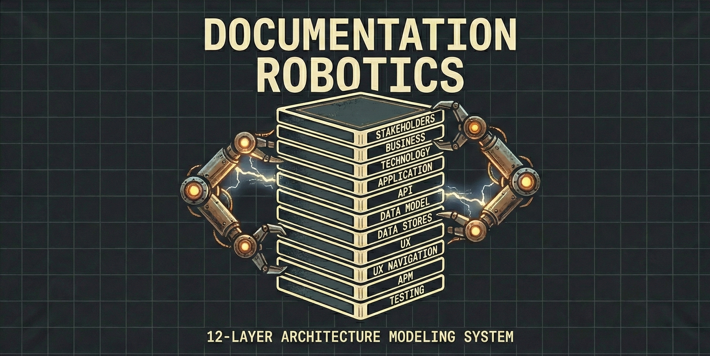

# Documentation Robotics



A full-stack software spec, as a graph: what a system is, what it is becoming, and how the two
check each other.

[](https://github.com/tinkermonkey/documentation_robotics/actions/workflows/cli-tests.yml)
[](spec/)
[](cli/)
[](LICENSE)

**New here? Start with the [overview](https://tinkermonkey.github.io/documentation_robotics/).** It explains the idea behind DR, follows one
feature through the 13 layers, and shows what each step gives you. This README is the quick start.

## What it is

Documentation Robotics (DR) keeps a typed graph of your whole system: the goals it serves, the
features and services that deliver them, the APIs, schemas, tables and screens that implement them,
and the spans and tests that watch and prove them. You extract the graph from your code, refine it,
and explore it. Then you plan each change on it as a changeset, which DR checks against everything
the change touches before the code is written, and against the build once it is.

| Part               | What it does                                                                                                                  |
| ------------------ | ----------------------------------------------------------------------------------------------------------------------------- |
| `dr`               | The CLI: create, validate, migrate and export models                                                                          |
| `dr mcp`           | The MCP server: the whole workflow as tools for an agent                                                                      |
| `dr visualize`     | The [viewer](https://github.com/tinkermonkey/documentation_robotics_viewer): the graph, changesets on it, and comment threads |
| Claude Code plugin | Loads the MCP server in every session and adds `/dr-plan`, the DR agents and the layer skills                                 |

## Install

Requires Node.js 18 or later and [Claude Code](https://claude.com/claude-code). Extraction reads code
through [codebase-memory-mcp](https://github.com/DeusData/codebase-memory-mcp).

```bash
npm install -g @documentation-robotics/cli codebase-memory-mcp
claude plugin marketplace add tinkermonkey/documentation_robotics
claude plugin install dr@documentation-robotics
```

The plugin serves whichever project a Claude Code session has open; there is nothing to configure
per project. To update later, run `npm update -g @documentation-robotics/cli`, then
`claude plugin marketplace update documentation-robotics` and
`claude plugin update dr@documentation-robotics`.

## Quick start

Open Claude Code in your repository and work through these in order. Each step is useful on its
own; the [overview](https://tinkermonkey.github.io/documentation_robotics/#get-started) says what each one unlocks.

| Step                   | Ask Claude                                                                           |
| ---------------------- | ------------------------------------------------------------------------------------ |
| 1. Set up              | `What's the DR status of this repo?`                                                 |
| 2. Extract             | `Index this repo and extract a DR model from the code.`                              |
| 3. Refine              | `Open the extraction for review, then help me add the goals and features it serves.` |
| 4. Explore             | `Which API operations have no test sketch or span?`                                  |
| 5. Plan a change       | `/dr-plan let admins export orders as CSV`                                           |
| 6. Build, verify, land | `Build it from the brief, then verify the branch against the plan.`                  |

Steps 2, 3 and 5 stage their work in a changeset. You review it on the graph in the viewer
(`review_open` gives the link) and confirm the commit yourself; for a planned change, that happens
in the pull request that ships the code. How planning works:
[`docs/CHANGE_MODELING.md`](docs/CHANGE_MODELING.md).

### Without an agent

The CLI does the same things by hand:

```bash
dr init --name "My Project"
dr add motivation goal "Improve Customer Satisfaction" --attributes '{"priority":"high"}'
dr add application applicationservice "Checkout" --attributes '{"serviceType":"synchronous"}'
dr schema relationship application.applicationservice   # what a type may connect to
dr validate

dr changeset create add-order-export --description "Let admins export orders as CSV"
dr add application applicationfunction "Export Orders"
dr relationship add application.applicationfunction.export-orders \
  application.applicationservice.checkout --predicate realizes
dr changeset preview            # the model with the change applied
dr changeset commit             # when the code that builds it lands
```

Other commands:

- `dr visualize` serves the viewer, with DrBot (`--with-changesets` lets it stage changes for you
  to review).
- `dr upgrade --dry-run` migrates a model to the current spec version.
- `dr conformance`, `dr audit`, `dr trace`, `dr stats` check and explore a model.
- `dr export <format>`: ArchiMate, OpenAPI, JSON Schema, PlantUML, GraphML, Markdown, Mermaid.
- `dr analyzer` indexes a codebase with codebase-memory-mcp.
- `dr farm` manages a set of models across repositories.
- `dr claude install` / `dr copilot install` copy the agents, commands and skills into a project, for
  GitHub Copilot or a project-scoped Claude Code setup. With Claude Code, the plugin above is simpler.

The full command reference is in [`cli/README.md`](cli/README.md).

## The 13 layers

| #   | Layer                                                | Focus         | Standard      |
| --- | ---------------------------------------------------- | ------------- | ------------- |
| 01  | [Motivation](spec/layers/01-motivation.layer.json)   | WHY           | ArchiMate 3.2 |
| 02  | [Business](spec/layers/02-business.layer.json)       | WHAT          | ArchiMate 3.2 |
| 03  | [Product](spec/layers/03-product.layer.json)         | WHAT DELIVERS | _Custom_      |
| 04  | [Security](spec/layers/04-security.layer.json)       | WHO CAN       | _Custom_      |
| 05  | [Application](spec/layers/05-application.layer.json) | HOW           | ArchiMate 3.2 |
| 06  | [Technology](spec/layers/06-technology.layer.json)   | WITH WHAT     | ArchiMate 3.2 |
| 07  | [API](spec/layers/07-api.layer.json)                 | INTERFACE     | OpenAPI 3.0   |
| 08  | [Data Model](spec/layers/08-data-model.layer.json)   | STRUCTURE     | JSON Schema   |
| 09  | [Data Store](spec/layers/09-data-store.layer.json)   | STORAGE       | SQL DDL       |
| 10  | [UX](spec/layers/10-ux.layer.json)                   | PRESENTATION  | _Custom_      |
| 11  | [Navigation](spec/layers/11-navigation.layer.json)   | FLOW          | _Custom_      |
| 12  | [APM/Observability](spec/layers/12-apm.layer.json)   | OBSERVE       | OpenTelemetry |
| 13  | [Testing](spec/layers/13-testing.layer.json)         | VERIFY        | _Custom_      |

Relationship direction follows the predicate, not the layer order; the
[design charter](spec/DESIGN_CHARTER.md) says what the spec, its nodes and its relationships are for,
and how a change to them is judged.

## Documentation

| Read                                                                    | For                                                                           |
| ----------------------------------------------------------------------- | ----------------------------------------------------------------------------- |
| [Overview](https://tinkermonkey.github.io/documentation_robotics/)      | The idea, a worked example, the adoption path, and where things stand         |
| [`docs/CHANGE_MODELING.md`](docs/CHANGE_MODELING.md)                    | How a change is planned, pressure-tested, verified and landed; every MCP tool |
| [`docs/EXTRACTION_STRATEGY.md`](docs/EXTRACTION_STRATEGY.md)            | How extraction reads code, and its measurements                               |
| [`docs/VISION.md`](docs/VISION.md)                                      | The reasoning, status, sequencing and open questions, for contributors        |
| [`spec/`](spec/) and [`spec/DESIGN_CHARTER.md`](spec/DESIGN_CHARTER.md) | The specification, and how a change to it is judged                           |
| [`cli/README.md`](cli/README.md)                                        | Every CLI command                                                             |
| [`integrations/claude_code/`](integrations/claude_code/)                | The plugin's agents, commands and skills                                      |

## Repository structure

```text
documentation_robotics/
├── spec/              # The specification (source of truth)
│   ├── layers/        #   13 layer instance files (.layer.json)
│   ├── schemas/       #   Node and relationship schemas, base schemas, predicates
│   └── dist/          #   Compiled spec (generated, committed)
├── cli/               # The dr CLI (TypeScript)
│   ├── src/           #   commands, core, validators, export, analyzers, mcp, server
│   └── tests/         #   unit, integration, smoke
├── integrations/      # Claude Code and GitHub Copilot agents, commands, skills
├── docs/              # Strategy and design: extraction, change modeling, analyzers, vision
└── site/              # The overview page, published to GitHub Pages
```

## Contributing

- [CONTRIBUTING.md](CONTRIBUTING.md): general guidelines
- [spec/CONTRIBUTING.md](spec/CONTRIBUTING.md): specification changes
- [spec/GOVERNANCE.md](spec/GOVERNANCE.md): spec governance
- [RELEASE_PROCESS.md](RELEASE_PROCESS.md): releases (Semantic Versioning 2.0.0)
- Changelogs: [spec](spec/CHANGELOG.md), [CLI](cli/CHANGELOG.md)
- The overview page is `site/index.html`; merging a change to it publishes the site.

Questions go to [GitHub Discussions](https://github.com/tinkermonkey/documentation_robotics/discussions),
bugs to [GitHub Issues](https://github.com/tinkermonkey/documentation_robotics/issues).

## License and acknowledgments

MIT, see [LICENSE](LICENSE). Documentation Robotics builds on ArchiMate® (a registered trademark of
The Open Group), the OpenAPI Specification (OpenAPI Initiative), JSON Schema, OpenTelemetry (Cloud
Native Computing Foundation) and W3C Trace Context.
